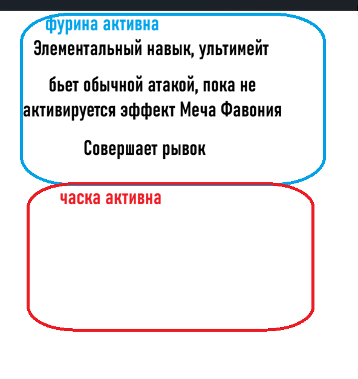

# Человекочитаемая ротация: исходная идея и требования

<!-- handoff-current: readable-rotation-editor -->
Reviewed 2026-10-09. Владелец — execution chat Readable
из [общей TODO](../../TODO.md). Рабочее окно и текстовый Readable подключены в GCSIM Browser.
Человек отверг первоначальную читаемость/компоновку; финальная UI-приёмка открыта.

Общие условия и личные варианты используют то же дерево через панель свойств.
Незаполненные места остаются явными; Code и блоки имеют общий undo/redo.

Реестр вариантов пока Беннет/Часка/Фурина. Только явный выбор создаёт видимые
условия/подготовку; импорт не исправляется. Шаблон Часки 1–5 пуль ограничен
C0–C5; C6 допускает 6 пуль. Таймер не доказывает отсутствие эффекта, а условие
до очереди не гарантирует режим при исполнении.

Исправлены сохранение выбранного действия/места вставки
и применение варианта повторяемой атаки. Группы «Персонажи», «Циклы»,
«Условия», «Ожидание и прочее» постоянно видны над прокруткой команд.
Персонаж открывает действия в командах с «Назад»; свойства содержат варианты
выбранного блока. Удаление условия сохраняет обе ветки по порядку; удаление
персонажа удаляет его действия. Зависимые циклы/области видимости защищены.
Меню/условия/начальный персонаж ограничены
выбранной командой; ограничения проверяются ядром и UI.
Команда берётся из явных virtual keys и сохранённых account keys по stable ID,
без угадывания по имени/исходному коду. Смена команды сохраняет черновик и
блокирует старое применение. Документированные запреты/недостающие action metadata
не обходятся структурной вставкой. Часка aim:4 преобразуется с четырьмя явными
итерациями подготовки; повторная смена заменяет точный старый план.

[Receipt исправлений и инвентаризация личных механик](../rotation-evidence/2026-10-09_editor_repairs.md)
владеют проверками предыдущего исправления. Новый
[receipt импорта и уточнений](../rotation-evidence/2026-10-09_rotation_import.md)
содержит живой поиск KQM и проверку в полном AppShell: результат сразу в
Code/Readable, отдельный выбор альтернатив. Пустая команда раньше давала ошибку
за пределами экрана; теперь сообщение рядом с поиском. Бой не проверен. Сохранён
[исторический receipt рабочего окна](../rotation-evidence/2026-10-09_editor_window.md).
[Примеры условий/вариантов](../rotation-evidence/2026-10-09_conditions_variants.md),
[словарь блоков](../rotation-evidence/2026-10-08_blocks.md),
[полный технический словарь](../rotation-evidence/2026-10-08_dictionary.md) и
[исторический receipt ядра](../rotation-evidence/2026-10-08_core.md).
Универсальное человеческое упрощение любого GCSL ещё не выполнено.

MVP ориентируется на импорт готовой ротации и резервное редактирование.
Далее — читаемость/перетаскивание вложенных цветных окон по наброску и
групповой аудит переходов личных механик, включая Варесу. Не спрашивать
о каждой кнопке. Проверка реальных задержек — позже.
Особые описания ограничены fingerprint 75 аудированных исходников.
Полный resolver локализованных имён остаётся открытым.
Loader/сетевой fallback/кэш опций и полная локализация личных механик остаются
отдельной интеграцией. Локальная модель отложена. «Найти ротацию» подключено:
точный состав, приоритет C+оружие → другие оружия → другие C, альтернативы,
оригинальное описание, текст, загрузка только программы сразу в основной Code/Readable.
Черновик редактирования сохраняется отдельно. PvP получает команду выбранного места.
Сборки не применяются; неизвестный синтаксис/особое начальное состояние явно
блокируют автоматический перенос. Перевод описаний и запись нажатий не реализованы.
Аккаунты, optimizer и движок не изменены. Однократная автоматизация отключена.
<!-- /handoff-current -->

## Реализованный изолированный контракт

Ядро находится в `run_workspace/gcsim/rotation_editor/`; оно не импортирует
настройки, аккаунтные каталоги или UI. Существующая проектная локализация
внедряется через `translate`, имена — через `resolve_name`. Терминальный preview
читает явно выбранный публичный source. Только для встроенного публичного
примера внедряются четыре имени из помеченного fixture; для произвольного файла
сохраняются стабильные ключи. Производственный resolver подключается из
подготовленных проектных записей на интеграционном этапе, новая база имён
приложения не создана.

- `parse(source, Dialect)` создаёт общий `Document`: исходник, узлы с ID,
  диапазоны символов, trivia и диагностика. `Document.byte_span` явно переводит
  диапазон в UTF-8 байты. Поддержаны формы выбранного языка из словаря;
  неизвестный/слишком глубоко вложенный фрагмент сохраняется как `unknown`.
  Вход ограничен 2 MiB, это техническая граница прототипа.
- `write(document)` сохраняет нетронутые участки; структурная запись использует
  то же дерево. Изменённые контейнеры сохраняют комментарии, но при удалении/
  замене контейнера расположение комментария может измениться. Вставка и
  перестановка сохраняют границы комментариев оставшихся команд.
- `EditorSession` хранит текущий черновик и максимум 50 undo-состояний.
  `last_complete` означает последний синтаксически разобранный документ,
  а не готовность к симуляции. `commit` проверяет незаполненные места,
  повторный разбор и совпадение структуры; для явно выбранного аудированного
  профиля проверяет настройки. Переданные опции добавляют проверки действий.
  Неуспешная проверка не заменяет текущий черновик старым кодом.
- `action`, `conditional`, `loop` создают те же узлы для будущих кнопок.
  Действие требует явного участника; незаполненный слот не превращается в
  придуманное условие. Произвольный обычный текст не является входным языком.
- `render` группирует окна персонажей, сохраняет ветвления, циклы, функции,
  типы, параметры и управление. При неоднозначном участнике не назначает
  окно. Переопределённые системные функции остаются явными вызовами; после
  прямого `return`/`break`/`continue`/`fallthrough` хвост помечен невыполняемым.
- `semantics.analyze` распознаёт доказанные пользовательские блоки без правки
  импорта. `make_cycle` / `make_schedule` создают обычные узлы общего дерева;
  `context_for` описывает свойства выбранного узла. `EditorSession.edit_option`
  меняет их с теми же undo и проверкой записи. Редактируются число ротаций,
  расписание, повтор действия, распознанные условия и явный выбор варианта.
  Неподдержанные выражения/параметры не объявляются готовыми простыми редакторами.
  Настройки симуляции находятся в `details`.
- `conditions` распознаёт и создаёт условия теми же обычными узлами дерева.
  `Condition` — временное значение свойств, не отдельный сохранённый документ.
  `variants` выдаёт планы видимых условий/подготовки и применяет их только
  при явном изменении варианта. Реестр ограничен аудированным профилем и
  проверенными примерами Беннета/Часки/Фурины; новые metadata сами по себе
  не разрешают старые механические предположения для другого движка.
- `load_source_dialect` читает два явно выбранных generated-реестра персонажей,
  новые aliases не требуют нового списка в приложении. Реестр не доказывает
  совместимость новой грамматики или старых специальных переводов: профиль
  `gcsim-v2.45.0-gcsl` включает их только по решению адаптера.

## Рабочее окно — 9 октября 2026

`ui/gcsim_browser/rotation_editor.py` — отдельное разворачиваемое окно;
`rotation_properties.py` — временные контролы свойств. Кнопка в существующем
GCSIM Browser открывает черновик из текущего поля Code. Builder tab остаётся
отключённым. Readable сразу строит компактный обычный текст из текущего Code:
соседние действия объединяются, циклы/ветки сохраняются. При вводе в видимой
вкладке обновление собирается через 200 ms; вход во вкладку обновляет сразу.
Это просмотр основного кода, а не ещё неприменённого черновика. По кнопке
«Применить к ротации» черновик проверяется и заменяет основное поле только при
неизменённых исходном тексте, identity движка и контексте выбранной команды.
Результат поступает через прежний `rotation_text_changed`; optimizer/run не
менялись. При конфликте код сохраняется в редакторе. Явная кнопка замены
черновика основным кодом перезагружает его; закрытие само по себе этого не делает.

`editing.Selection` обозначает исходный узел или диапазон исходных команд
проекции окна персонажа. `insert/remove/move/wrap` изменяют существующие списки
того же AST; новый документный контейнер персонажа не вводится. Вставка после
среднего действия разделяет строку, сохраняя порядок соседей. Перестановка
доступна для отдельных действий/команд; окно персонажа целиком пока не
переставляется кнопками. При удалении/оборачивании окна учитывается весь его
диапазон, включая скрытые простые swap и вложенные условия. Неизменённый код
сохраняется дословно; комментарии при структурном удалении могут переместиться.

Пустые условия и тела остаются `hole`; Code для такого структурного черновика
не показывается как прежний готовый код. Raw Code с ошибками доступен для
исправления, структурные изменения к нему блокируются. Ввод собирается через
250 ms; переключение вкладки, деталей и действия принудительно разбирает
последний ввод. Старые callbacks свойств после такого разбора не применяются.
Undo/redo общий для кода и блоков, максимум 50 состояний. Размер входа ядра
ограничен 2 MiB; UI показывает первые 400 блоков и явно оставляет полный Code.

`integration.load_environment` выполняет ограниченное чтение установленного
движка при открытии и применении. Аудированная интерпретация допущена только
при совпадении source repo/ref и fingerprint 75 перечисленных файлов. Это
проверка выбранной области source, не исполнительного файла или всей версии.
Неизвестная сборка сохраняет Code/обычные команды; специальные конструкторы
условий и личных вариантов не включаются предположительно. Binding включает
aliases, локальные docs, профиль и manifest hash; `source_revision` не подставлен.
Сетевой fallback личных механик/его persistent cache/loader не подключены.
Отдельный поиск ротаций KQM описан ниже. Локализация окна есть
в ru/en/pt-br; полные имена персонажей и документы новых механик — дальнейшая
интеграция, без угадывания ключей по переведённым именам.

Пользователь одобрил структуру предварительно, до интерактивной пробы. Она
выявила ошибки поведения и неприемлемую читаемость. Поведение исправляется
перед большой работой над плотностью/цветом/визуальным обозначением блоков.
Группы команд постоянно видны вне прокручиваемого содержимого; выбор персонажа
открывает его действия в командах с «Назад», сохраняя место вставки в документе.
Свойства относятся только к выбранному блоку/варианту команды.
После добавления выбирается именно action,
а не невидимая сгруппированная action_line. Удаление выбирает оставшегося соседа
или родительское тело; undo/redo также сохраняют возможный контекст. Ошибка
видима у панели свойств. Личные механики не объявлены универсально поддержанными.
Аудит базы выполнен отдельным авторизованным чатом
`01a11edd-f8f4-7962-997a-49e5ba6038b9`; реализация поиска описана ниже,
перевод описаний остаётся отдельной интеграцией.

`team.TeamContext` — отдельный явный контекст команды, не часть редактируемого
документа. AppShell передаёт provider выбранной команды; отсутствие provider
не разрешает весь каталог. Account keys читаются текущим read-only запросом
по максимум четырём stable IDs, virtual keys берутся из overrides. Session
получает `allowed_actors` и action metadata: raw импорт сохраняется, новые
структурные запрещённые ссылки отклоняются до изменения history, commit
проверяет весь документ. Binding команды проверяется также в Browser.
Это проверка явных ссылок и документированных опций, не динамический анализ
любого пользовательского вызова. Недокументированные personal prerequisites
не угадываются; [инвентаризация](../rotation-evidence/2026-10-09_editor_repairs.md)
отделяет автоматические metadata от нуждающихся в аудите переходов состояния.

## Импорт и уточнения взаимодействия — 9 октября 2026

Кнопка «Найти ротацию» требует четыре распознанных участника выбранной команды.
`rotation_database` использует текущую публичную KQM API, точное множество
персонажей и ограниченные страницы, timeout, размер ответа и отмену между
запросами. UI не блокируется сетью, каталог хранится только в памяти текущего
диалога; ошибки, пустой и неполный поиск различаются. Неполный результат не
объявляется лучшим во всей базе. Приоритет: совпадение C и оружия; те же C с
другим оружием; другие C (число отличий, суммарная разница C, отличия оружия,
стабильный ID). R и сеты показаны для сравнения, таланты/статы/DPS не ранжируют.
Пропущенный в API C0 подтверждается явным `cons=0` в том же AST; неизвестное
значение не подменяется нулём.

Первый по приоритету из полученных вариантов сразу заменяет основную ротацию
и открывает Readable. «Другие ротации» открывает отдельный список. Строка содержит четыре
персонажа, C/оружие/R/сеты; иконки и имена используют существующие каталоги,
иначе остаётся ключ. Описание — только оригинальный авторский текст. Отдельные
вкладки показывают читаемую ротацию, будущий код и исходный конфиг справочно.
Google/Yandex-перевод не подключён: нужны официальный провайдер/учётные данные
и настройки, а не скрытый неофициальный endpoint.

`rotation_import.prepare_rotation` удаляет только распознанные setup spans,
сохраняя функции (в том числе до сборок), переменные, комментарии, исходный
порядок и действия. Чужие сборки/окружение не применяются. Используются текущие
options/target/energy/hurt Browser с явной подсказкой об отличиях. Для
бесконечного повтора с прежним манекеном HP=999999999 используется существующая
политика режима длительности (своя duration либо 90 секунд); изменение обозначено
в сообщении результата и preview. Особые начальные char params, неизвестный синтаксис/зависимые
setup, отсутствие явного active или слишком большой итог не импортируются
автоматически; исходник остаётся доступным. Это не гарантия исполнения любого
конфига базы с иной сборкой или средой.

«Найти ротацию» запускает фоновый поиск без промежуточного окна. Успешный ответ
заменяет основной Code одной отменяемой правкой; отдельный черновик сохраняется,
его старое применение блокируется до перезагрузки. Ревизия Code, поколение
контекста команды, C/оружие/R и identity движка защищают от позднего ответа,
включая правку/возврат Code и смену команды туда-обратно. Явный выбор альтернативы
снова использует текущие условия боя. Результаты старой команды/движка требуют
нового поиска. Пустая команда, неизвестные ключи, отсутствие движка, ошибка сети
и неподдержанный первый вариант показываются непосредственно рядом с кнопкой;
при неуспехе основной код сохраняется. Поиск не выводит состав из примерного кода.
Встроенный PvP Browser получает отдельный provider команды своего места игрока.
Смена оборудования не меняет editor membership.

Удаление внешнего if извлекает then и else по порядку; вложенные if остаются.
Простой цикл и распознанный счётный цикл без использования счётчика в теле
извлекают тело. Зависимости счётчика, break/continue и перенос местных переменных
блокируются объяснением; содержимое сохраняется. Окно персонажа владеет своими
действиями и удаляет весь свой диапазон. Всё проходит через общий AST/undo.

Зафиксированное направление MVP: редактирование готовых импортов как резервный
режим; целевой охват — весь исполняемый язык базы с честным raw fallback до
полного покрытия. Визуальный следующий этап — цветные вложенные мини-окна с
именем/возможной иконкой, перетаскивание за край и перемещение вложенных команд
как Scratch, по сохранённому рисунку пользователя. Нынешняя компоновка не
объявляется соответствующей рисунку. Переходы личных механик должны отличать
доказанный вариант от зависящего от состояния; Вареса ещё не покрыта.

Запись нажатий исследована, не реализована: Windows позволяет key/mouse events,
время, горячую клавишу и topmost Start/Stop. Нажатия не доказывают принятые игрой
действия. Возможен черновик с выбранной командой/начальным персонажем и границами
таймлайна, схлопыванием повторных кликов и явным подтверждением неоднозначных
действий; точный автономный конвертер не подтверждён. Источники и пример Варесы
сохранены в [receipt](../rotation-evidence/2026-10-09_rotation_import.md).

## Первая идея пользователя — 8 октября 2026

Текст ротации, набранный кодом в окне «Code», должен превращаться в понятный
обычный язык в окне «Readable». Те же структурированные команды в дальнейшем
должны стать основой панели редактирования с кнопками. Все кнопки, вероятно,
не поместятся на одной площади: нужна группировка по типам действий.

Работа делится на две задачи: сначала структура команд, допустимые комбинации
и защита от ошибок; затем визуальный дизайн, расположение, встроенная панель
или отдельное окно и связанные способы настройки. Не выбирать компоновку
до разбора языка и обсуждения структуры.

## Уточнённый порядок и сценарии использования — 8 октября 2026

- Продвинутый пользователь пишет Code и может прочитать Readable.
- Казуальный пользователь позже находит готовую ротацию кнопкой «Найти
  ротацию» и читает, что импортировал. На 8 октября поиск не являлся
  предпосылкой переводчика; текущая реализация описана в разделе импорта.
- Редактирование текстовыми шаблонами/кнопками должно создавать код по той же
  структуре команд. Доступность этого режима казуальному пользователю нужно
  оценить по полному словарю, прежде чем проектировать панель.
- Первый приоритет — понятное объяснение существующего кода. Полная таблица
  конструкций и разные пограничные примеры подготовлены в связанном словаре.
  При дальнейшей работе различать сложность однозначного перевода и сложность
  самостоятельного составления. Выбор стратегии обсуждать для целых групп
  конструкций, а не задавать вопросы о каждой отдельной кнопке во время работы.
- Простая команда, условие и вложенный цикл — отдельные составляемые части.
  Пример с Фавонием не задаёт универсальную кнопку или особую грамматику.
  Разные сценарии выражаются разными явными условиями/действиями/вложенностью;
  не объединять их скрытым выбором поведения. Не согласовывать каждую кнопку
  отдельным ситуативным вопросом: обсуждается общая структура словаря.
- Локальная модель отложена: она добавляет потребление памяти/CPU или GPU и
  поддержку совместимости. Прежняя оценка сохранена в словаре как исследование
  варианта; обучение, скачивание и зависимости не входят в текущий этап.

## Исходный пример и рисунок

Пользовательский пример: выбрать «Сделать активным» → «Фурина», затем назначить
элементальный навык и ультимейт, обычные атаки до активации эффекта Меча
Фавония, рывок; следующая область относится к Часке. Это пример желаемого
чтения, а не доказательство конкретного синтаксиса, статуса или времени GCSIM.

Рисунок — предоставленная пользователем постоянная публичная reference asset,
57,258 байт; исходный PNG сохранён без изменений. Цветные обводки, заголовки
«Фурина активна»/«Часка активна» и действия внутри областей передают идею
группировки. Цвета и геометрия ещё не утверждены как дизайн приложения.

## Разбор GCSIM перед выбором кнопок

- Пройти индекс всей официальной документации и зафиксировать охват тем и
  ссылки на первоисточники. Для каждой конструкции, влияющей на ротацию,
  определить синтаксис, смысл, параметры, зависимости и применимость к
  установленной версии. Темы, которые относятся к конфигурации/CLI/данным,
  отделить от действий ротации с объяснением границы.
- Сопоставить официальные сведения с реальным parser/adapter приложения и
  доступными возможностями выбранного движка. Дата сайта не доказывает
  поддержку конструкции старой установленной сборкой. Не запускать симуляции
  или обновление движка ради данного исследования.
- Составить таблицу «конструкция → читаемая команда → параметры → возможный
  тип элемента панели → ограничения/валидация». Охватить действия, выбор
  персонажа, ожидания, повторения, условия/выражения, проверки эффектов,
  комбинации и специфичные для персонажей/оружия параметры, где они реально
  поддержаны. Не выдумывать универсальную кнопку для непроверенной семантики.
- Продумать группы по типам действий и композицию команд, а не только список
  плоских кнопок. Сложные конструкции могут требовать вложенных блоков,
  редактора параметров или сохранения исходного кода.
- Таблица должна включать весь словарь, а не выбранный набор MVP. Возможный
  элемент панели — предварительная классификация после оценки сложности,
  не готовая компоновка. Отдельно перечислить общие формы языка, системные
  функции, поля условий и специфичные параметры персонажей/оружия/наборов.

## Структура команд, контекст и ошибки

- Основной Readable — понятные пользовательские блоки, не построчный перевод
  программного синтаксиса. Подтверждённый счётный цикл читается «Цикл из N
  ротаций», вложенный — «Повторить N раз»; расписание использует номера с 1.
  Подробная логика доступна в свойствах, если безопасного упрощения нет.
- Общая контекстная панель обслуживает любой выбранный блок. Для цикла это
  число повторов/расписание, для действия — варианты и параметры, для персонажа
  — личные механики. Выбор в навигации команд меняет кнопки и имеет «Назад».
  Категории вводятся по объёму содержимого, не ради дробления на мелкие кнопки.
- Импорт не вставляет навык Часки перед `aim[bullets=...]`: действительный режим
  зависит от состояния; повторный `skill` может завершить режим. Явный выбор
  специального варианта в прототипе создаёт подготовку под условием отсутствия
  режима и повторную проверку перед атакой. Шаблон 1–5 пуль ограничен видимым
  условием C0–C5. Проверка перед очередью не доказывает сохранение состояния
  до исполнения. Показ задержек из прогона — идея отдельного этапа.
- Таймеры личных/общих статусов и булевы состояния не смешиваются. Ноль на
  таймере может соответствовать активному постоянному эффекту или точному
  кадру его истечения. Даже Фавоний подписывается как таймер перезарядки,
  а не как доказательство нового срабатывания/готовности эффекта.
- Code, Readable и кнопки связаны через один документ: исходник, дерево
  конструкций и привязки к диапазонам кода. Кнопки меняют узлы/поля дерева,
  Readable отображает их; переводимые фразы не служат промежуточным языком
  генерации. Разбор и обратную запись разрабатывать вместе с первого этапа.
- Структура охватывает действия, параметры-выражения, условия, все формы
  циклов, функции/вызовы, переменные/области видимости, управление выполнением
  и настройки выбранной версии GCSIM. Не сводить полный язык к плоскому списку
  атак. Сохранять комментарии, скобки, повторы и нетронутые участки исходника.
- Парсер GCSIM служит проверкой совместимости, но его преобразованный AST
  недостаточен для хранения редакторского документа: он разворачивает повторы
  и теряет комментарии. Конкретный разбор и формат внутренних узлов выбираются
  в изолированном прототипе. Незаполненные места представлены как черновики,
  а неизвестные конструкции — как видимые пробелы покрытия, не готовый перевод.
- Для будущего builder команда «Сделать активным» выбирает конкретного
  персонажа. Если активного персонажа нет, назначение требующих его действий
  блокируется и контекстное сообщение объясняет, что сначала нужно выбрать
  активного персонажа. Нельзя молча выбирать случайного/первого участника.
- Учитывать смену персонажа и неоднозначный контекст внутри ветвлений и
  повторений. Отличать явно назначенного участника от текущего активного;
  вывод должен следовать подтверждённой семантике языка.
- Показывать понятные ошибки синтаксиса, параметров, условий и неподдержанных
  конструкций с местом в коде. Builder не должен создавать заведомо
  недопустимую комбинацию. Статические ограничения не выдавать за полный
  контроль боевой выполнимости, энергии или таймингов симуляции.
- Повторения и ожидания эффекта описываются как условия, а не как обещание
  срабатывания или точного времени. Не скрывать лимиты, единицы времени,
  дополнительные параметры или существенные проверки.

## Readable и язык интерфейса

- Начальный активный персонаж, явное переключение и автоматическое
  переключение перед действием другого персонажа используют один вид окна
  с заголовком и действиями внутри. Начало окна заменяет отдельную фразу
  «персонаж становится активным»; это уточнение пользователя к наброску.
  Окно — визуальная группировка общего дерева; исходный способ переключения
  сохраняется для обратной записи. Условия/циклы не разворачиваются и не
  скрываются ради группировки; вычисляемый участник остаётся явно вычисляемым.
- Выбор окна открывает раздел личных механик этого персонажа. Параметры
  действий и поля состояния для условий занимают разные типы мест в дереве.
  Условие может ссылаться на другого участника и не создаёт его активное окно.
- Названия персонажей, оружия и эффектов желательно получать из существующей
  базы/каталога на языке интерфейса; если этого названия нет — использовать
  любое доступное название в детерминированном порядке. При полном отсутствии
  имени показать исходный стабильный ключ и объяснить отсутствие перевода.
  Перевод имени не меняет идентичность или код GCSIM.
- Использовать проектные RU/EN/PT-BR локализацию и каталоги, а не создавать
  вторую базу имён. Первые примеры могут быть русскими, но lookup/fallback и
  шаблоны должны учитывать текущий язык интерфейса.
- Соблюдать грамматику в заранее известных сочетаниях и шаблонах. Для
  произвольных собственных имён допускаются корректные нейтральные обороты
  и кавычки. Не вводить тяжёлую морфологическую библиотеку или огромный
  хардкод без обоснования; границы склонений явно описать.

## Предложения для обсуждения

Оставшиеся детали взаимодействия, пока не являющиеся выбором пользователя:

- Связать строку/блок Readable с исходным диапазоном Code: нажатие помогает
  найти оригинал, а диагностике есть куда вести пользователя.
- Предусмотреть отмену правок общей модели. Свободное редактирование обычного
  текста и автоматическое обратное преобразование на первом этапе не обещаны.
- Различать текущий текст и последнее успешно разобранное представление;
  ошибка нового ввода не должна незаметно оставлять старую ротацию как актуальную.

Исполнитель предлагает дополнительные улучшения и существенные решения для
обсуждения на конкретных примерах. Обычные обратимые детали прототипа решает
самостоятельно в пределах действующих требований.

## Личные механики и резервное получение опций

Пользователь согласовал объединение поставляемых проверенных описаний известных
персонажей с данными выбранного движка для новых персонажей. Он требует
предусмотреть резервную докачку и кэширование: под лоудером либо при первом
выборе окна нужного персонажа в редакторе, включая сценарий обновления движка
без перезапуска приложения. Обновление приложения должно оставаться совместимым
с этим механизмом. Сервис получения/кэша реализован изолированно; реальные
loader/panel hooks и поставляемый полный набор описаний ещё не подключены.

В выбранном source описание находится в `internal/characters/<key>/config.yml`;
pipeline собирает `Params`, `Fields`, `Actions` в
`ui/packages/docs/src/components/*/character.dm.json`. Эти локальные данные
Часки повторно сверены с публичным v2.45.0: `bullets` есть в Params, а
`bullet1`…`bullet6` реализованы в `Condition` Go-кода и отсутствуют в Fields.
Диапазон 1…6 дан текстом; дополнительная проверка C6 находится в реализации.
Таким образом, таблицы позволяют обнаружить часть новых опций, но не являются
полной машинной схемой типов, диапазонов и всех специальных ограничений.
Источники: [описание Часки](https://github.com/genshinsim/gcsim/blob/20d8f7706cc7209afffd6f21aff351c7d9a73398/internal/characters/chasca/config.yml),
[Condition](https://github.com/genshinsim/gcsim/blob/20d8f7706cc7209afffd6f21aff351c7d9a73398/internal/characters/chasca/chasca.go),
[стрельба](https://github.com/genshinsim/gcsim/blob/20d8f7706cc7209afffd6f21aff351c7d9a73398/internal/characters/chasca/aimed.go),
[генератор](https://github.com/genshinsim/gcsim/blob/20d8f7706cc7209afffd6f21aff351c7d9a73398/pipeline/character.go).

Технический контракт и граница текущей реализации:

- Один сервис опций обслуживает оба входа: подготовку под лоудером и первый
  выбор персонажа. Сначала использует совместимые поставляемые описания,
  кэш и данные установленного движка. Сеть нужна только при отсутствии
  нужных исходных данных; обязательное ожидание сети не задерживает запуск.
- Докачивать только данные официального источника, соответствующие выбранной
  сборке/ревизии, а не произвольный новейший справочник. Если соответствие
  недоказуемо, сохранить доступный базовый режим и обозначить недостающие
  описания. Не скачивать модель, исполняемые плагины или весь движок ради опций.
- Новые параметры в известных формах языка получают универсальные поля и
  исходные подсказки. Проверенные переводы/специальные элементы дополняют ту
  же схему. Из свободного текста подсказок не угадывать тип, диапазон или
  применимость ограничения. Универсальный анализ произвольной Go-механики
  не входит в первый кодовый этап.
- Идентичность результата включает fingerprint выбранного движка/источника,
  стабильный ключ персонажа и версию формата кэша. Совместимость поставляемых
  описаний учитывается отдельно. Изменение языка UI не меняет identity опции;
  старые специальные ограничения не переносятся на новую реализацию молча.
- После смены движка без перезапуска первый выбор персонажа проверяет новую
  identity. Повторные запросы одного результата объединяются; фоновый ответ
  для прежней сборки не подменяет опции уже выбранной новой сборки. Логика
  работает вне UI-потока, с ограниченными ожиданием и повторными попытками.
- Кэш отделён от поставляемого словаря и пользовательских ротаций. Обновление
  приложения проверяет версию формата, использует совместимую запись либо
  пересоздаёт её; запись атомарная, неполный результат не вытесняет рабочий.
  Недоступная сеть не повреждает исходник ротации и уже доступные опции.
- Постоянный кэш добавляется только вместе с конечными лимитами хранения,
  подключённой очисткой и проверками сохранения ротаций/поставляемых данных
  по [DATA_WORK_RULES.md](DATA_WORK_RULES.md). Хранить компактные извлечённые
  данные для используемой/rollback сборки, не копии исходных деревьев.

Изолированный этап использует публичные fixtures и внедряемые источники/хранилище;
подключение к реальному лоудеру, engine-update и панели относится к следующей
интеграции. Контракт этих входов и смены версии закладывается в ядро заранее.

`CharacterOptionService.prepare` и `select_character` используют один путь:
кэш → внедрённые локальные таблицы → отсутствующие официальные таблицы строго
по переданному 40-hex source commit. Строка версии бинарника не считается
доказательством этого commit; без него сеть не используется. Таблицы читаются
не более одного раза для текущей identity, одинаковые запросы объединяются,
старые queued-запросы отменяются, поздний ответ старой версии не выдаётся новой.
Параметры и condition fields остаются отдельными коллекциями.

Кэш имеет schema 1, checksum, атомарную запись; неполный ответ не кэшируется.
Лимиты по умолчанию: 32 записи / 4 MiB, до 2 фоновых потоков, до 64 физических
заданий и максимум 2 управляемые попытки одного запроса. Каждая официальная
таблица ограничена 2 MiB, сетевое ожидание — 5 секунд на таблицу. Очистка
подключена в конструктор кэша, получение и запись: только собственные filenames,
старые известные форматы удаляются, активные temp защищены, abandoned temp
удаляются после часа. Пользовательские ротации, поставляемые данные, symlinks
и записи более нового формата сохраняются. Проверки очистки выполнялись
только в `TemporaryDirectory`; реальный каталог кэша не создан.

## Идеи пользователя для будущего режима шаблонов/кнопок

Эти идеи сохранены для отдельного этапа проектирования взаимодействия. Это
не утверждённая компоновка и не разрешение сейчас реализовать панель.

- При добавлении «Если» возникает блок с двумя явными местами заполнения:
  «если: {необходимо вставить условие}» и
  «то: {необходимо вставить действие}». Для незаполненного места предложены
  красный фон и серый текст подсказки.
- Блок повторения предлагается читать как
  «делай: {введите действие}» / «пока: {введите условие}».
  Семантика `while` проверяет условие перед первым выполнением; расположение
  этих подписей не должно незаметно менять смысл исходного языка.
- Блоки кликабельны. Когда выделен блок «если–то», добавляемая конструкция
  «делай, пока выполняется условие» прикрепляется к нему как вложенный блок.
  Точное место вставки/выделения внутри сложного блока ещё предстоит определить.
- Когда выделено пустое место с подсказкой
  «{кликните здесь чтобы писать новую команду}», та же команда создаёт новый
  самостоятельный блок.
- Оценить, смогут ли люди без знания кода пользоваться составляемыми
  условиями/циклами. Сначала обсуждаются словарь и сложность; плотность,
  клики, подсветка, встроенное/отдельное окно и окончательный дизайн — позже.

## Приёмка этапов и границы

Словарь и обсуждение структуры завершили подготовку к изолированному ядру.
Приёмка ядра включает Code → дерево → Code вместе с Readable на публичных
входах: смена персонажа, параметры-выражения, условия/повторения, функции и
области видимости, неизвестная конструкция, незавершённый ввод и отсутствие
активного персонажа. Проверять дословное сохранение нетронутого кода, повторный
разбор изменённого документа и совместимость с парсером выбранной версии.
Проверять смысл независимо от реализации; совпадение текста с собственными
шаблонами не доказывает перевод. Полнота языка и удобство кнопок — разные границы.

Для опций проверить холодный/готовый кэш, нового персонажа, смену движка без
перезапуска и устаревший фоновый ответ, отсутствие сети, несовместимый формат
после обновления приложения, очистку без затрагивания ротаций. Изолированные
проверки сервиса выполнены на fixtures и временном кэше; подключение реального
лоудера, обновления движка и панели ещё требует интеграционной приёмки.

Второй этап разрабатывает компоновку и дизайн после согласования структуры.
Прототип и автоматические/offscreen проверки не означают установленный
production editor или приёмку физических кликов. Установка в текущий AppShell,
новые зависимости с существенной ценой, аккаунтные данные, Engine/optimizer
изменения и Git-переносы не разрешаются данным эскизом автоматически.
